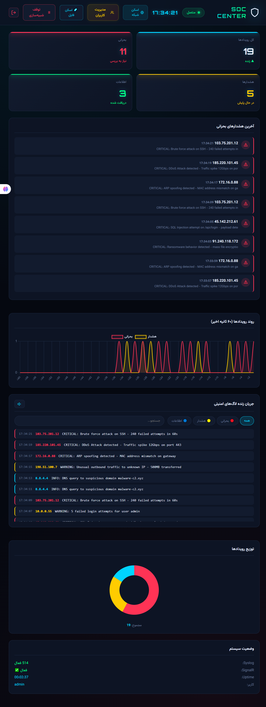
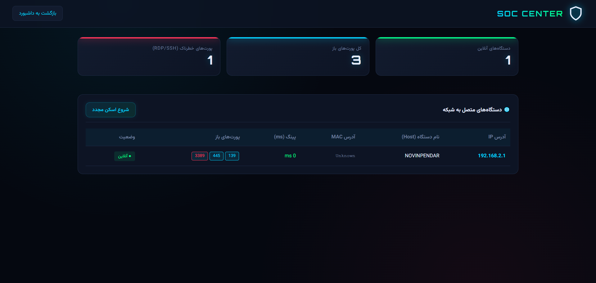

# 🛡️ SOC Center

**A Modern, Real-Time Security Operations Center (SOC) & Network Operations Center (NOC) Dashboard**
> 🌐 Language: The user interface is natively built in Persian (Farsi) with full RTL (Right-to-Left) support, styled with the beautiful *Vazirmatn* font.

<br>

| 🛠️ Backend | 🚨 Real-Time | 🗄️ Database | 🎨 Frontend | 🔐 Security |
| :---: | :---: | :---: | :---: | :---: |
| C# 12 / .NET 8 | SignalR / WebSockets | SQLite / EF Core | HTML5 / CSS3 | JWT / BCrypt |
| ASP.NET Core | Live Audio API | Structured Logging | Vanilla JS / Chart.js | Role-Based Access |

<br>

*Built with C#, ASP.NET Core, SignalR, and Vanilla JavaScript.*

</div>

---

## 📖 Overview

**SOC Center** is a comprehensive, full-stack cybersecurity dashboard designed to monitor network activity, detect threats, manage users, and visualize security events in real-time. It combines the functionalities of a **Security Operations Center (SOC)** and a **Network Operations Center (NOC)** into a single, beautifully designed, cyberpunk-themed interface.

Whether you are simulating cyber attacks, monitoring live Syslog traffic, scanning your local network, or analyzing files for malware, SOC Center provides a professional-grade experience.

---

## ✨ Key Features

### 🚨 Security Operations (SOC)
- **Real-time Event Streaming:** Live security logs powered by **SignalR**.
- **Live Analytics:** Interactive charts (Line & Donut) displaying threat severity and trends.
- **Attack Simulator:** One-click simulation of various cyber attacks (DDoS, Brute Force, SQLi, XSS, Ransomware) to test the system.
- **Audio Alerts:** Real-time Web Audio API beeps for critical and warning events.
- **File Scanner (VirusTotal):** Upload files to scan them using the VirusTotal API (includes a Demo mode for safe testing).
- **Syslog Listener:** Built-in UDP listener on port `514` to receive real logs from routers and firewalls.

### 🌐 Network Operations (NOC)
- **Network Scanner:** Discover live devices on your local subnet.
- **Port Scanner:** Scan common open ports (HTTP, SSH, RDP, FTP, etc.) on discovered devices.
- **MAC Address Resolution:** Retrieve MAC addresses via ARP.
- **Device Discovery:** Identify gateways, routers, and connected clients.

### 🔐 Security & User Management
- **JWT Authentication:** Secure login system using JSON Web Tokens.
- **Role-Based Access Control (RBAC):** Three distinct roles: `Admin`, `Analyst`, and `Viewer`.
- **User Management Panel:** Admins can create, delete, and lock/unlock user accounts.
- **Brute-Force Protection:** Accounts are automatically locked after 5 failed login attempts.
- **Structured Logging:** Powered by **Serilog** (Output to Console and daily rolling files).

---

## 🛠️ Tech Stack

| Domain | Technologies |
| :--- | :--- |
| **Backend** | C# 12, ASP.NET Core 8, Entity Framework Core |
| **Real-time** | SignalR (WebSockets) |
| **Database** | SQLite |
| **Security** | JWT Bearer, BCrypt.Net-Next |
| **Logging** | Serilog |
| **Frontend** | HTML5, CSS3, Vanilla JS, Chart.js |
| **External APIs** | VirusTotal API v3 |

---

## 🚀 Quick Start

Follow these steps carefully to run the project on your local machine.

### Prerequisites
- [.NET 8.0 SDK](https://dotnet.microsoft.com/download) installed on your system.
- Visual Studio 2022, VS Code, or a command-line terminal.
- *(Optional)* A free [VirusTotal API Key](https://www.virustotal.com) for real file scanning.

### Step-by-Step Installation

**1. Clone the repository:**
```bash
git clone https://github.com/YOUR_USERNAME/SOC-NOC-Dashboard.git
cd SOC-NOC-Dashboard/SocCenter
```

**2. Restore NuGet packages:**
Navigate to the project folder in your terminal and run:
```bash
dotnet restore
```

**3. Database Initialization (Automatic):**
You don't need to create a database manually. On the first run, the application will automatically generate a fresh SQLite database (`soc.db`) and create the default administrator account.

**4. Run the Application (Crucial Step):**
> ⚠️ **Important:** You **must** run the application with **Administrator privileges**. This is required because:
> - The **Syslog listener** needs to bind to UDP port `514`.
> - The **Network Scanner** needs permissions to execute `arp` commands and perform Port Scans.

**If using Visual Studio:**
Right-click on Visual Studio -> Select **"Run as administrator"** -> Open the project -> Press `F5` or click the green Run button.

**If using VS Code or Terminal:**
Open your terminal as Administrator (Command Prompt/PowerShell), navigate to the `SocCenter` folder, and run:
```bash
dotnet run
```

**5. Access the Dashboard:**
Open your web browser and go to the URL shown in your terminal (usually `https://localhost:7198` or similar).
- 👤 **Default Username:** `admin`
- 🔑 **Default Password:** `Admin@123`

**6. Optional: VirusTotal Setup**
To use the real file scanner, open `appsettings.json` and replace `"YOUR_API_KEY_HERE"` with your actual VirusTotal API key. *(Note: The file scanner has a built-in Demo mode that works perfectly without an API key).*

---

## 🖼️ Screenshots

*(Add your screenshots here to make the repository shine!)*

> **Dashboard View**
> 
> 
> **Network Scanner**
> 
---

## ⚠️ Disclaimer

This project is created for **educational and portfolio purposes**. The "Attack Simulator" does not perform real attacks; it only generates simulated log events via SignalR. Always ensure you have legal authorization before scanning networks or ports that you do not own.

---

## 📄 License

This project is licensed under the MIT License - see the [LICENSE](LICENSE) file for details.

<div align="center">
  <i>Built with ❤️ for Cyber Security Enthusiasts</i>
</div>
```
